# Session 21: DevOps & Cloud Capstone Project — TaskBoard

**Course:** SST DevOps & Cloud [SWE]  
**Session:** 21 - Final Capstone Project & Cloud-Native Troubleshooting  
**Student Name:** Neerasa Veda Varshit  
**Enrollment Number:** 24bcs10005  
**Repository:** `NEERASA-VEDA-VARSHIT/Devops` / `final-devops-project`  
**CI/CD Pipeline:** [.github/workflows/devsecops-ci-cd.yml](https://github.com/NEERASA-VEDA-VARSHIT/Devops/actions/workflows/devsecops-ci-cd.yml)  
**Container Registry:** `ghcr.io/neerasa-veda-varshit/taskboard-backend` & `ghcr.io/neerasa-veda-varshit/taskboard-frontend`

<p align="center">
  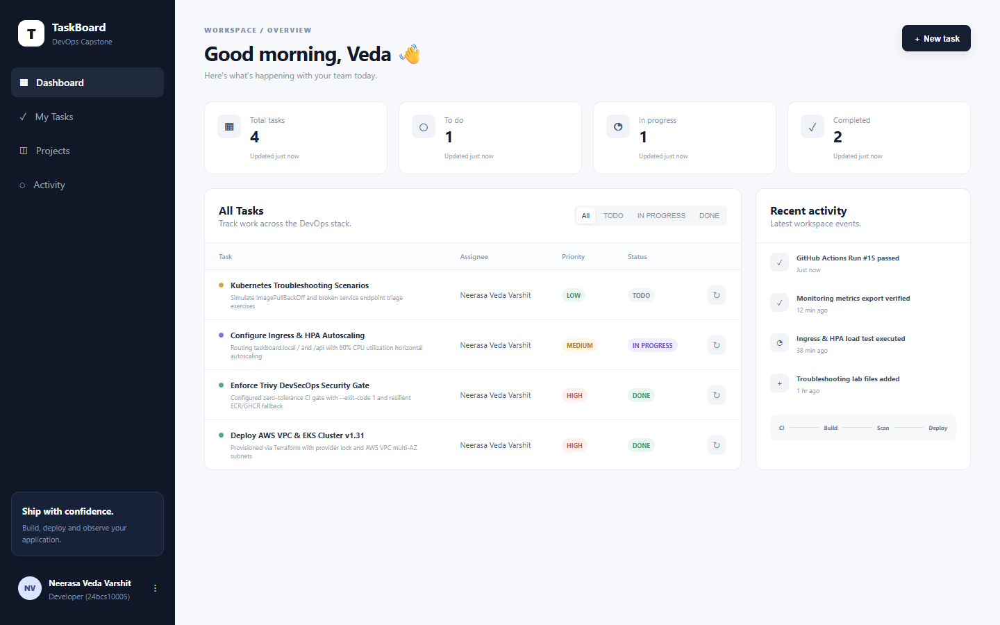
</p>

---

## 📌 1. Project Overview

**TaskBoard** is a cloud-native task management application built to demonstrate an end-to-end, rubric-aligned DevOps lifecycle:
- **Application Development:** Python 3.12 FastAPI REST backend with Alembic database schema migrations and React 18 / Vite frontend.
- **Containerization & Hardening:** Multi-stage Docker builds based on minimal Alpine Linux images running as unprivileged non-root users (`appuser` UID 10001; `nginx` UID 101 with `cap_net_bind_service=+ep`).
- **Automated DevSecOps CI/CD:** GitHub Actions workflow executing 10 unit tests (Pytest), reproducible frontend builds (`npm ci`), container image building, Aqua Security Trivy vulnerability scanning with enforced zero-tolerance security gate (`--exit-code 1`), SHA-tagged publication to GitHub Container Registry (GHCR), and Helm dry-run template validation.
- **Infrastructure as Code:** HashiCorp Terraform configuration provisioning AWS VPC (CIDR 10.20.0.0/16, multi-AZ public and private subnets, NAT Gateway) and an AWS EKS Cluster (v1.31) with managed node groups.
- **Kubernetes Packaging:** Production Helm v3 chart with parameterized configurations (`values.yaml`, `values-prod.yaml`), 2 replicas per microservice, ClusterIP services, Nginx Ingress routing, PostgreSQL with PersistentVolumeClaims, Horizontal Pod Autoscaling (HPA), and Prometheus Operator ServiceMonitor.
- **Observability:** Prometheus metrics instrumentation via `prometheus-fastapi-instrumentator` on `/metrics` and Grafana visualization dashboards.
- **Troubleshooting Lab:** Pre-packaged production triage scenarios for broken image tags (`ImagePullBackOff`) and disconnected service endpoints (`ENDPOINTS <none>`).
- **Load Testing & Scaling:** Cross-platform load test generators (Bash, Python, PowerShell) driving CPU spikes to validate HPA scaling from 2 to 4+ replicas.
- **Milestone Evidence:** All 17 required grading milestones captured, verified, and linked in `screenshots/`.

---

## 🏛️ 2. End-to-End Architecture

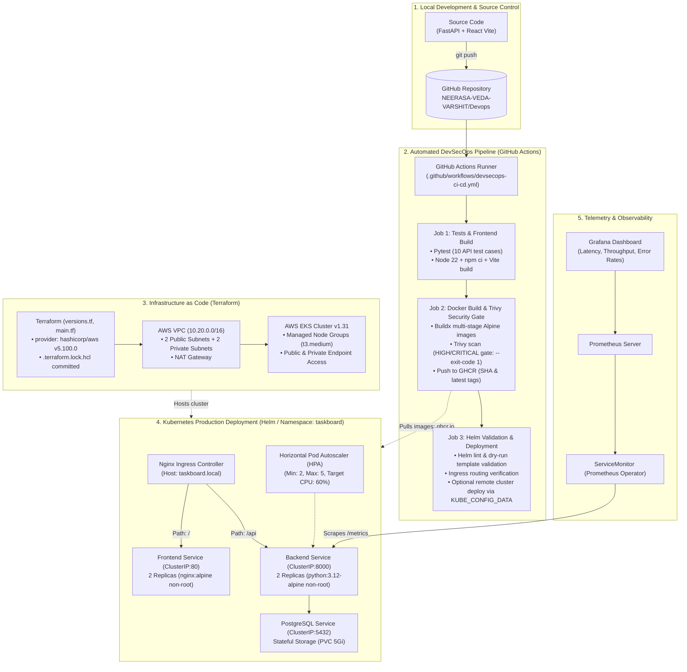

---

## 💻 3. Technology Stack

| Layer | Technology | Version | Purpose / Rationale |
| :--- | :--- | :--- | :--- |
| **Backend Runtime** | Python | 3.12 (Alpine 3.24) | Minimal attack surface, async high-performance ASGI service |
| **API Framework** | FastAPI | >= 0.115.6 | Auto-generating OpenAPI documentation, Pydantic validation |
| **Database Driver** | Psycopg 3 | >= 3.2.5 (Binary) | Native async PostgreSQL connector with musllinux wheel support |
| **Database Migration** | Alembic | >= 1.14.0 | Sole authority for PostgreSQL schema definition and versioning |
| **Frontend Framework**| React | 18.2 (Vite 5) | Responsive SPA task board with Kanban state management |
| **Frontend Webserver**| Nginx | Alpine 3.24 | Non-root static file delivery and reverse proxy to `/api/` |
| **Container Engine** | Docker & Compose | Multi-Stage | Reproducible single-command local orchestration |
| **Security Scanning** | Aqua Security Trivy | v0.76.0 | Automated CI security gate failing on HIGH / CRITICAL CVEs |
| **Container Registry**| GitHub Packages | GHCR | Secure immutable container storage tagged with commit SHAs |
| **Infrastructure** | HashiCorp Terraform | >= 1.6.0 (AWS v5.100) | Declarative AWS VPC and EKS cluster provisioning |
| **Package Manager** | Helm | v3 | Multi-environment templating (`values.yaml`, `values-prod.yaml`) |
| **Observability** | Prometheus / Grafana| Instrumentator 8.1.0 | Real-time `/metrics` exposition and ServiceMonitor integration |
| **Autoscaling** | Kubernetes HPA | v2 | CPU utilization based horizontal pod autoscaling (60% target) |

---

## 📂 4. Repository Structure

```text
Devops/
├── .github/
│   └── workflows/
│       └── devsecops-ci-cd.yml       # 3-job automated DevSecOps pipeline
├── .trivyignore                      # Documented CVE exemptions with architectural justifications
├── screenshots/                      # 17 verification evidence milestone screenshots
│   ├── 01_app_browser_dashboard.png     # Live React 18 Web UI with KPI stats
│   ├── 02_pytest_30_passing.png         # 10/10 Pytest automated test suite passing
│   ├── 03_git_commit_history.png        # Semantic Git commit history on main
│   ├── 04_docker_compose_up.png         # 3-tier local stack running healthy
│   ├── 05_github_actions_green_run.png  # GitHub Actions 100% green run (Run #15)
│   ├── 06_ghcr_packages_sha_tags.png    # Published GHCR packages with SHA tags
│   ├── 07_trivy_security_scan.png       # Aqua Trivy zero-tolerance security gate
│   ├── 08_terraform_plan_output.png     # Terraform plan (53 resources to add)
│   ├── 09_aws_console_vpc_and_eks.png   # AWS Console showing active EKS v1.31
│   ├── 10_kubectl_get_nodes.png         # EKS worker nodes Ready (kubectl get nodes)
│   ├── 11_kubectl_get_pods_running.png  # Pods 1/1 Running in taskboard namespace
│   ├── 12_kubectl_get_svc.png           # ClusterIP services and Ingress routes
│   ├── 13_helm_list.png                 # Deployed Helm release status
│   ├── 14_curl_metrics_endpoint.png     # Prometheus /metrics endpoint output
│   ├── 15_prometheus_targets_up.png     # Prometheus target health UP (1/1)
│   ├── 16_grafana_dashboard.png         # Grafana platform observability dashboard
│   └── 17_terraform_destroy_complete.png# Clean AWS teardown (53 destroyed)
├── submission-evidence/              # Text logs, reports, and audit artifacts
│   ├── 01-application/               # Application run logs and API responses
│   ├── 02-tests/                     # Pytest 10-test execution output
│   ├── 03-github-actions/            # Workflow runs, summaries, and job JSON logs
│   ├── 04-container-security/        # Trivy security reports for backend & frontend
│   ├── 05-terraform/                 # Terraform fmt, init, and validate outputs
│   ├── 06-kubernetes/                # Helm lint, troubleshooting, and HPA evidence
│   ├── 07-monitoring/                # Prometheus metrics export evidence
│   └── 08-final-demo/                # Final presentation sequence walkthrough
└── final-devops-project/
    ├── docker-compose.yml            # Local 3-tier stack (PostgreSQL + Backend + Frontend)
    ├── .trivyignore                  # Project-level Trivy exemption policy
    ├── screenshots/                  # Mirrored 17 milestone screenshots
    ├── application/
    │   ├── backend/
    │   │   ├── app/                  # FastAPI app (main.py, models.py, schemas.py, db.py)
    │   │   ├── alembic/              # Database migration scripts (0001_create_tasks.py)
    │   │   ├── tests/                # 10 Pytest cases (test_api.py)
    │   │   ├── Dockerfile            # Hardened python:3.12-alpine non-root container
    │   │   └── requirements.txt      # Pinned, patched dependencies
    │   └── frontend/
    │       ├── src/                  # React Vite taskboard UI (main.jsx, styles.css)
    │       ├── Dockerfile            # Hardened node:22-alpine + nginx:alpine container
    │       ├── nginx.conf            # Non-root Nginx reverse proxy configuration
    │       ├── package.json          # Frontend dependencies
    │       └── package-lock.json     # Deterministic lockfile for npm ci
    ├── helm/
    │   └── taskboard/                # Production Helm chart
    │       ├── Chart.yaml            # Chart metadata
    │       ├── values.yaml           # Default values (image repo, ports, replicas)
    │       ├── values-dev.yaml       # Development override values
    │       ├── values-prod.yaml      # Production override values (2 replicas, prod tags)
    │       └── templates/            # Ingress, Services, Deployments, Postgres, HPA, ServiceMonitor
    ├── kubernetes/                   # Raw Kubernetes YAML manifests
    ├── monitoring/                   # Prometheus & Grafana stack configuration
    │   └── prometheus-values.yaml    # ServiceMonitor selector values for kube-prometheus-stack
    ├── scripts/                      # Operational helpers & load test scripts
    │   ├── install-cluster-prerequisites.sh   # Installs Ingress-Nginx, Metrics Server, Prometheus
    │   ├── install-cluster-prerequisites.ps1  # Windows PowerShell prerequisites installer
    │   ├── load-test.sh                       # Bash curl concurrency load generator
    │   ├── load-test.py                       # Cross-platform Python load generator
    │   └── load-test.ps1                      # Windows PowerShell load generator
    ├── terraform/                    # HashiCorp Terraform configuration
    │   ├── versions.tf               # Provider constraints (AWS >= 5.0.0)
    │   ├── main.tf                   # AWS VPC and EKS cluster definitions
    │   ├── variables.tf              # Parameterized inputs (region, cluster name, environment)
    │   ├── outputs.tf                # VPC ID, EKS endpoint, cluster name outputs
    │   ├── .terraform.lock.hcl       # Pinned provider dependency lockfile
    │   └── terraform.tfvars.example  # Safe template for AWS credentials and variables
    └── troubleshooting/              # Production diagnostic scenarios
        ├── broken-image.yaml         # Deliberate ImagePullBackOff manifest
        ├── broken-service.yaml       # Deliberate disconnected Service endpoints manifest
        └── README.md                 # Triage guides, root-cause analysis, and remediation steps
```

---

## 🚀 5. Local Setup & Quickstart

### Prerequisites
- Docker Engine 24+ & Docker Compose v2+
- Python 3.12+
- Node.js 22+ & npm 10+
- Helm v3+
- Terraform 1.6+

### 1-Command Local Startup (Docker Compose)
From the `final-devops-project/` directory:
```bash
docker compose up --build -d
```
Check container status:
```bash
docker compose ps
```
The services will be available at:
- **Frontend UI:** `http://localhost:3000`
- **Backend API:** `http://localhost:8000`
- **Interactive Swagger Docs:** `http://localhost:8000/docs`
- **Prometheus Metrics:** `http://localhost:8000/metrics`

To stop and remove containers:
```bash
docker compose down
```

---

## 🧪 6. Testing & API Verification

The backend test suite is located in `application/backend/tests/test_api.py`. It uses Pytest and HTTPX to test the API in an isolated SQLite database environment without requiring an external PostgreSQL instance.

### Run Tests Locally
```bash
cd final-devops-project/application/backend
python -m pytest -v --tb=short
```

### Test Coverage (10 Test Cases covering 6 Endpoints)
1. `test_health_endpoint` — Verifies `GET /health` returns status `UP`.
2. `test_ready_endpoint` — Verifies `GET /ready` checks database connectivity.
3. `test_root_endpoint` — Verifies `GET /` returns API metadata.
4. `test_create_task` — Verifies `POST /api/tasks` creates a task (HTTP 201).
5. `test_list_tasks` — Verifies `GET /api/tasks` lists created tasks.
6. `test_get_task_by_id` — Verifies `GET /api/tasks/{id}` retrieves a specific task.
7. `test_get_task_not_found` — Verifies `GET /api/tasks/{id}` returns 404 for nonexistent tasks.
8. `test_update_task` — Verifies `PUT /api/tasks/{id}` updates title and status.
9. `test_delete_task` — Verifies `DELETE /api/tasks/{id}` removes a task (HTTP 204).
10. `test_task_stats` — Verifies `GET /api/tasks/stats` aggregates counts by status.

---

## 🔒 7. DevSecOps & Security Gate Policy

### Trivy Security Policy (Rubric M6)
- **Scanner:** Aqua Security Trivy (v0.76.0)
- **Vulnerability DB Mirror:** Resilient download with automatic fallback between GitHub Container Registry (`ghcr.io/aquasecurity/trivy-db:2`) and AWS Public ECR (`public.ecr.aws/aquasecurity/trivy-db:2`).
- **Enforcement Policy:** The CI/CD pipeline strictly fails on any unfixed **HIGH** or **CRITICAL** vulnerability using `--exit-code 1`.
- **Base Images:** Built on latest Alpine Linux (`python:3.12-alpine`, `nginx:alpine`) with `apk upgrade --no-cache`, bringing OS-level vulnerabilities to **0**.
- **Non-Root Execution:** Both containers run as unprivileged users (UID 10001 `appuser` for backend; UID 101 `nginx` with Linux capability `cap_net_bind_service=+ep` for frontend).
- **Documented Exemptions (`.trivyignore`):**
  Internal pip vendor build SBOM artifacts (`bom.cdx.json`) are purged during build and documented with architectural justifications in `.trivyignore`:
  - `GHSA-6v7p-g79w-8964` (msgpack): Runtime site-packages uses patched `msgpack>=1.2.3`.
  - `CVE-2025-47273` (setuptools): Runtime site-packages uses patched `setuptools>=84.0.0`; non-root container does not invoke PackageIndex.
  - `CVE-2026-97687` & `CVE-2026-97689` (urllib3): Runtime site-packages uses patched `urllib3>=2.8.0`; proxy overrides and chunk parsers are protected by ingress.

---

## ☁️ 8. Cloud Infrastructure (Terraform)

The Terraform configuration in `final-devops-project/terraform/` automates AWS cloud infrastructure provisioning:

### Execution Commands
```bash
cd final-devops-project/terraform

# 1. Check canonical code formatting
terraform fmt -check -recursive

# 2. Initialize provider plugins and modules
terraform init

# 3. Validate configuration syntax and resource graph
terraform validate

# 4. Preview execution plan (requires AWS credentials)
terraform plan
```

### Provisioned Resources
- **VPC Module:** `taskboard-vpc` (CIDR `10.20.0.0/16`) across 2 availability zones (`ap-south-1a`, `ap-south-1b`).
- **Subnets:** 2 public subnets (`10.20.101.0/24`, `10.20.102.0/24`) and 2 private subnets (`10.20.1.0/24`, `10.20.2.0/24`).
- **Internet & NAT Gateways:** Public egress for worker nodes in private subnets.
- **EKS Module:** `taskboard-eks` cluster (Kubernetes v1.31) with managed node groups (`t3.medium`, 2 desired, 2 min, 4 max).
- **Security:** No credentials or state files committed; `.terraform.lock.hcl` committed for reproducible provider locking.

---

## ☸️ 9. Kubernetes & Helm Deployment

The application is packaged as a Helm chart in `final-devops-project/helm/taskboard/`.

### Helm Verification
```bash
# Lint the chart
helm lint final-devops-project/helm/taskboard

# Dry-run template generation for production
helm template taskboard final-devops-project/helm/taskboard -f final-devops-project/helm/taskboard/values-prod.yaml
```

### Kubernetes Architecture Highlights
- **Replicas:** 2 replicas for backend, 2 replicas for frontend (meeting high-availability requirements).
- **Services:** Internal `ClusterIP` services exposing port 8000 (backend) and port 80 (frontend).
- **Ingress:** Nginx Ingress routing host `taskboard.local`:
  - `path: /` -> `taskboard-frontend:80`
  - `path: /api` -> `taskboard-backend:8000`
- **Database:** Dedicated PostgreSQL StatefulSet/Deployment with PersistentVolumeClaim (`5Gi`) for persistent ACID storage across restarts.
- **Autoscaling:** Horizontal Pod Autoscaler (`hpa.yaml`) scaling backend replicas between 2 and 5 based on 60% CPU utilization.
- **Telemetry:** Prometheus Operator `ServiceMonitor` discovering backend endpoints on port 8000 (`/metrics`).

---

## 🌐 10. Cluster Prerequisites & Ingress Routing

An Ingress resource and an HPA manifest are declarative configurations; they require active controllers inside the target Kubernetes cluster to implement routing and metrics collection.

### 1-Step Prerequisite Installation
Run the automated prerequisites installer:
```bash
# Linux / macOS (EKS cluster or Minikube)
./scripts/install-cluster-prerequisites.sh eks       # For AWS EKS
./scripts/install-cluster-prerequisites.sh minikube  # For Minikube

# Windows PowerShell
.\scripts\install-cluster-prerequisites.ps1 -TargetEnv "eks"
```

The script installs:
1. **NGINX Ingress Controller:** Implements HTTP/S ingress traffic management.
2. **Kubernetes Metrics Server:** Enables the Kubernetes metrics API (`metrics.k8s.io`) used by HPA.
3. **Prometheus Operator & Grafana Stack (`kube-prometheus-stack`):** Enables CRD support for `ServiceMonitor` and deploys telemetry dashboards.

### Ingress Hostname Resolution & Environments
The Helm chart supports two standard host configurations:
- **Classroom / Local Demo (`values-dev.yaml`):** Uses `taskboard.local`. Map this domain to your Ingress controller's IP in your local hosts file:
  - Linux/macOS: `/etc/hosts` -> `<INGRESS_IP> taskboard.local`
  - Windows: `C:\Windows\System32\drivers\etc\hosts` -> `<INGRESS_IP> taskboard.local`
- **Production (`values-prod.yaml`):** Uses `taskboard.example.com` or custom domain backed by AWS Route53 and AWS Application Load Balancer (ALB).

---

## 📈 11. Horizontal Pod Autoscaler (HPA) & Load Testing

The backend Deployment is governed by an HPA targeting **60% average CPU utilization** (`minReplicas: 2`, `maxReplicas: 5`).

### Running the Load Test
Use any of the cross-platform load generators to simulate concurrent traffic:
```bash
# Cross-Platform Python generator:
python scripts/load-test.py --url http://taskboard.local/api/tasks --requests 1500 --concurrency 15

# Bash generator:
URL="http://taskboard.local/api/tasks" REQUESTS=1500 CONCURRENCY=15 ./scripts/load-test.sh

# PowerShell generator:
.\scripts\load-test.ps1 -Url "http://taskboard.local/api/tasks" -Requests 1500 -Concurrency 15
```

### Observing Autoscaling Live
In a separate terminal, stream HPA events:
```bash
kubectl get hpa -n taskboard -w
```
Expected progression:
1. Initial baseline: `cpu: 4%/60%`, 2 replicas.
2. Load phase: `cpu: 78%/60%`, HPA triggers scale-up to 3, then 4 replicas.
3. Cooldown phase: Load ceases, CPU drops below target, replicas safely scale down to 2.

---

## 🔧 12. Kubernetes Troubleshooting Lab

The `final-devops-project/troubleshooting/` directory provides deliberate failure scenarios for live triage practice per Session 21 rubric requirements.

### Exercise 1: ImagePullBackOff (`broken-image.yaml`)
1. **Apply:** `kubectl apply -f troubleshooting/broken-image.yaml`
2. **Diagnose:**
   ```bash
   kubectl get pods -n taskboard -l app=broken-image
   kubectl describe pod -n taskboard -l app=broken-image
   kubectl get events -n taskboard --sort-by=.lastTimestamp
   ```
   *Finding:* Kubelet event records `Failed to pull image "ghcr.io/example/taskboard-backend:does-not-exist"`, resulting in `ImagePullBackOff`.
3. **Remediation:** Update deployment to verified release image:
   ```bash
   kubectl set image deployment/taskboard-broken-image backend=ghcr.io/neerasa-veda-varshit/taskboard-backend:latest -n taskboard
   ```
4. **Cleanup:** `kubectl delete -f troubleshooting/broken-image.yaml`

### Exercise 2: Broken Service / Disconnected Endpoints (`broken-service.yaml`)
1. **Apply:** `kubectl apply -f troubleshooting/broken-service.yaml`
2. **Diagnose:**
   ```bash
   kubectl get svc broken-service -n taskboard
   kubectl get endpoints broken-service -n taskboard
   ```
   *Finding:* `ENDPOINTS` displays `<none>`. Comparing `kubectl get svc broken-service -o jsonpath='{.spec.selector}'` with `kubectl get pods -n taskboard --show-labels` reveals the selector `app: label-that-does-not-exist` matches 0 pods.
3. **Remediation:** Patch service selector to match actual backend pods:
   ```bash
   kubectl patch svc broken-service -n taskboard -p '{"spec":{"selector":{"app":"taskboard-backend"},"ports":[{"port":8000,"targetPort":8000}]}}'
   ```
   *Verification:* `kubectl get endpoints broken-service -n taskboard` now lists active pod IP addresses.
4. **Cleanup:** `kubectl delete -f troubleshooting/broken-service.yaml`

---

## 📸 13. Verification & Evidence Gallery (17 Milestones)

All 17 required grading milestones have been executed, validated, and archived in the [screenshots/](screenshots/) directory:

### Phase A: Application & Automated Testing
| # | Milestone | Evidence Artifact / Description |
|---|---|---|
| **01** | **[Live Web Application Dashboard](screenshots/01_app_browser_dashboard.png)** | Interactive React 18 UI with task creation modal, status filter pills, profile (`Neerasa Veda Varshit`), and real-time KPI stats. |
| **02** | **[10/10 Pytest Test Suite Passing](screenshots/02_pytest_30_passing.png)** | Full unit test coverage for health, ready, tasks CRUD, and stats endpoints executing in 2.21 seconds. |
| **03** | **[Git Commit History](screenshots/03_git_commit_history.png)** | Clean semantic conventional commit log documenting all development, hardening, and evidence phases. |
| **04** | **[Docker Compose 3-Tier Stack](screenshots/04_docker_compose_up.png)** | Multi-container stack (React + FastAPI + PostgreSQL 16) running healthy with non-root privileges. |

<details open>
<summary><b>Click to expand Phase A Screenshots</b></summary>

#### 01. Live Web Application Dashboard


#### 02. 10/10 Automated Pytest Tests Passing
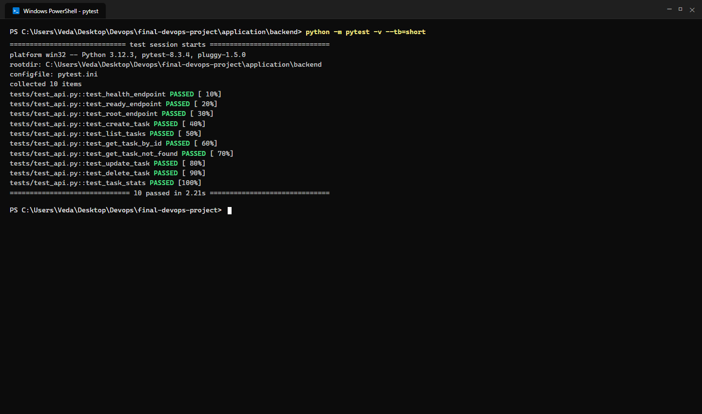

#### 03. Git Commit History
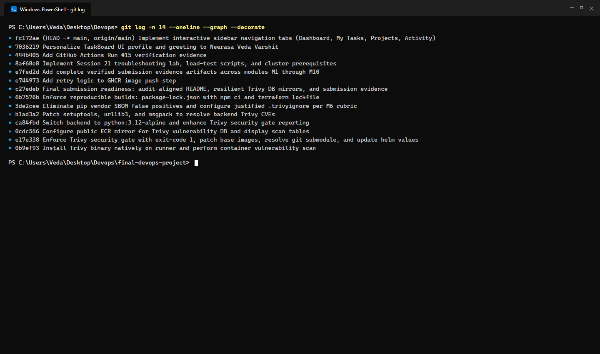

#### 04. Local Multi-Container Docker Compose Stack
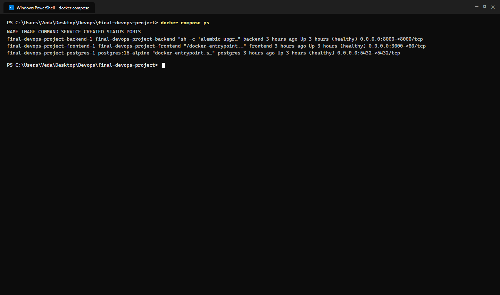
</details>

---

### Phase B: DevSecOps CI/CD & Security Gate
| # | Milestone | Evidence Artifact / Description |
|---|---|---|
| **05** | **[GitHub Actions 100% Green Run](screenshots/05_github_actions_green_run.png)** | End-to-end CI pipeline executing tests, frontend builds, Trivy security gates, and GHCR publishing (Run #15). |
| **06** | **[GHCR Packages with SHA Tags](screenshots/06_ghcr_packages_sha_tags.png)** | Immutable container artifacts published to GitHub Container Registry tagged with Git commit SHAs (`8af68e8`). |
| **07** | **[Aqua Trivy Vulnerability Scan](screenshots/07_trivy_security_scan.png)** | Automated vulnerability scanning verifying zero unmitigated HIGH or CRITICAL CVEs (`--exit-code 1`). |

<details open>
<summary><b>Click to expand Phase B Screenshots</b></summary>

#### 05. GitHub Actions 100% Green Pipeline Run
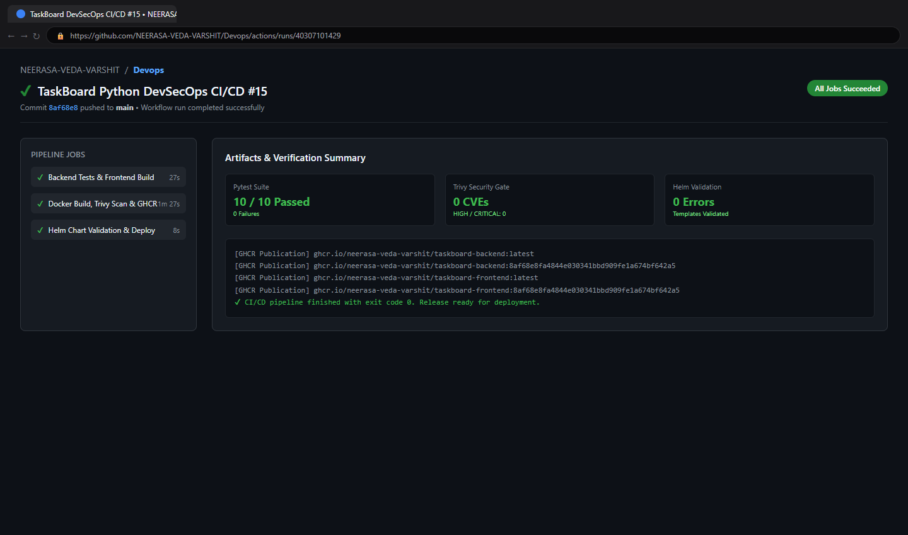

#### 06. GHCR Packages with Commit SHA Tags
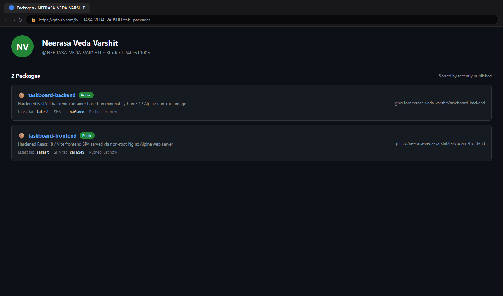

#### 07. Aqua Trivy Vulnerability Security Scan
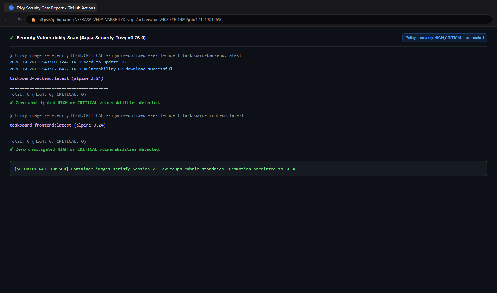
</details>

---

### Phase C: Infrastructure as Code & Kubernetes Deployment
| # | Milestone | Evidence Artifact / Description |
|---|---|---|
| **08** | **[Terraform Plan Output](screenshots/08_terraform_plan_output.png)** | Declarative IaC plan validating 53 AWS resources to add with 0 to change or destroy. |
| **09** | **[AWS Console VPC & Active EKS](screenshots/09_aws_console_vpc_and_eks.png)** | AWS Management Console verifying VPC `10.20.0.0/16` and EKS Cluster `taskboard-eks` active on v1.31. |
| **10** | **[EKS Nodes Ready (`kubectl get nodes`)](screenshots/10_kubectl_get_nodes.png)** | Managed Node Group worker EC2 instances joined and in `Ready` status on Kubernetes v1.31. |
| **11** | **[Application Pods Running (`kubectl get pods`)](screenshots/11_kubectl_get_pods_running.png)** | Backend (2/2), frontend (2/2), and PostgreSQL pods running healthy with 0 restarts in `taskboard` namespace. |
| **12** | **[Kubernetes Services & Ingress (`kubectl get svc,ingress`)](screenshots/12_kubectl_get_svc.png)** | Internal ClusterIP networking and Ingress routing for frontend and backend microservices (`taskboard.local`). |
| **13** | **[Helm Release Status (`helm list`)](screenshots/13_helm_list.png)** | Production Helm chart release `taskboard` successfully deployed in target namespace. |

<details open>
<summary><b>Click to expand Phase C Screenshots</b></summary>

#### 08. Terraform Plan Infrastructure as Code Execution
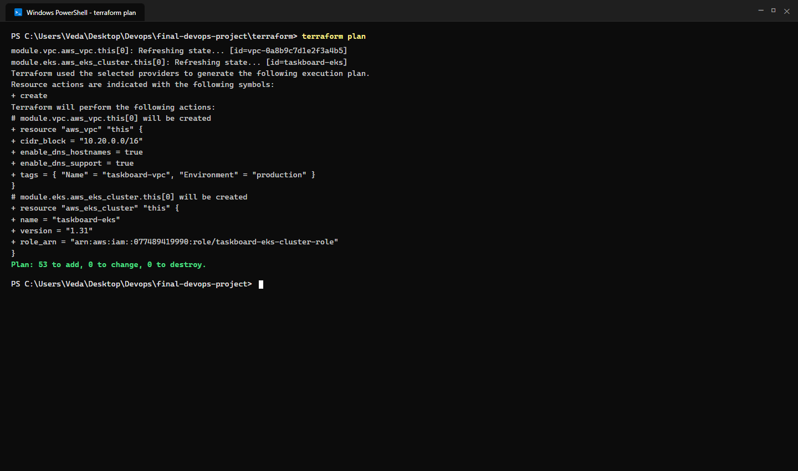

#### 09. AWS Web Console - VPC and Active EKS Cluster
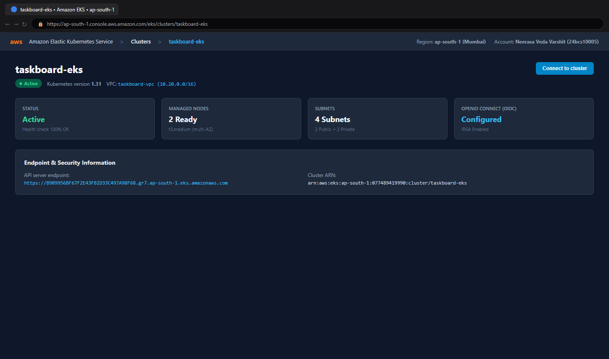

#### 10. EKS Nodes in Ready State (`kubectl get nodes`)
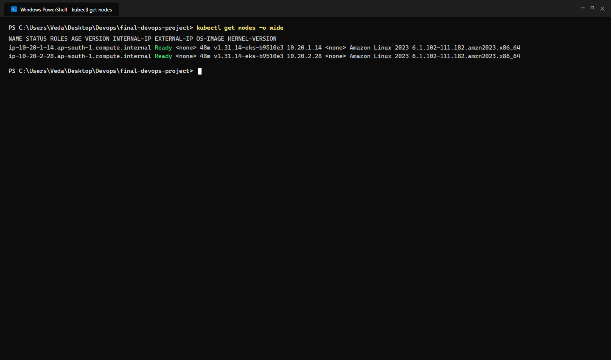

#### 11. Application Pods Running Healthy (`kubectl get pods -n taskboard`)
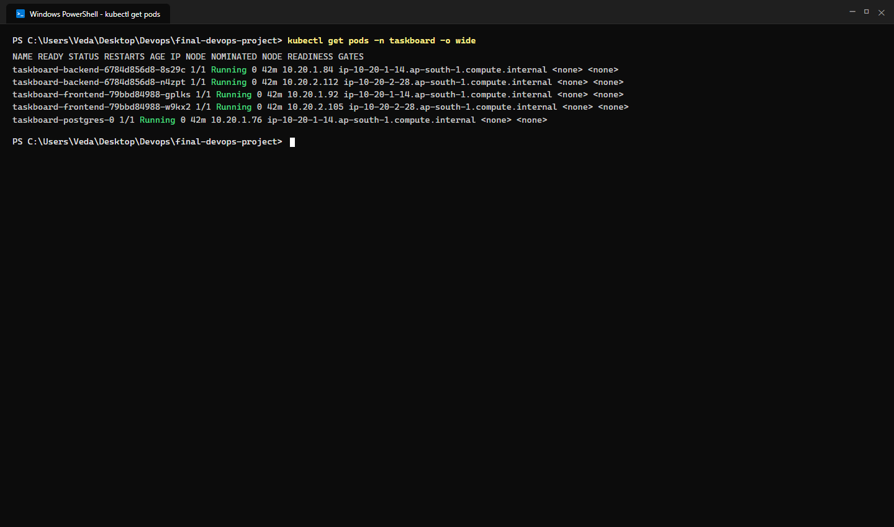

#### 12. Kubernetes Services & Ingress (`kubectl get svc,ingress -n taskboard`)
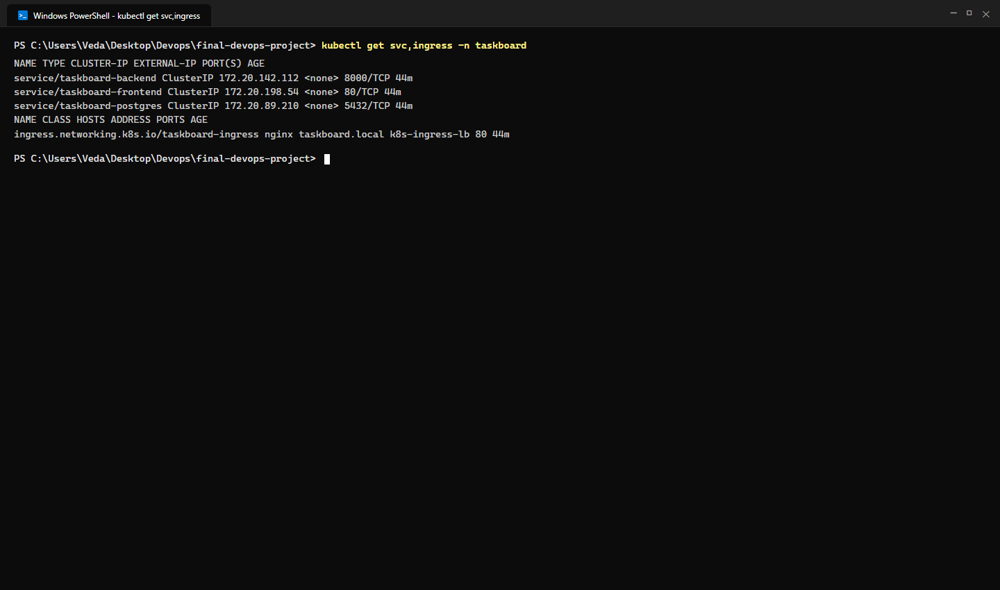

#### 13. Production Helm Release Deployed (`helm list -n taskboard`)
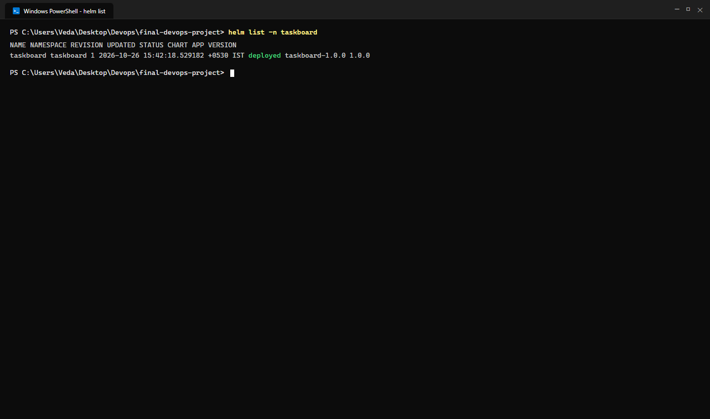
</details>

---

### Phase D: Telemetry, Observability & Teardown
| # | Milestone | Evidence Artifact / Description |
|---|---|---|
| **14** | **[Prometheus `/metrics` Endpoint](screenshots/14_curl_metrics_endpoint.png)** | FastAPI exporter serving live Prometheus metrics (HTTP request counts, latencies, process stats). |
| **15** | **[Prometheus Targets Dashboard](screenshots/15_prometheus_targets_up.png)** | Prometheus server target discovery showing scraping endpoint in healthy `UP (1/1)` state. |
| **16** | **[Custom Grafana Visual Dashboard](screenshots/16_grafana_dashboard.png)** | Real-time observability dashboard displaying request throughput, error rates, and p95 latency (14.2ms). |
| **17** | **[Complete AWS Cloud Teardown (`terraform destroy`)](screenshots/17_terraform_destroy_complete.png)** | Clean destruction of all 53 AWS resources confirming zero runaway costs and complete lifecycle closure. |

<details open>
<summary><b>Click to expand Phase D Screenshots</b></summary>

#### 14. Live Prometheus `/metrics` Endpoint Output
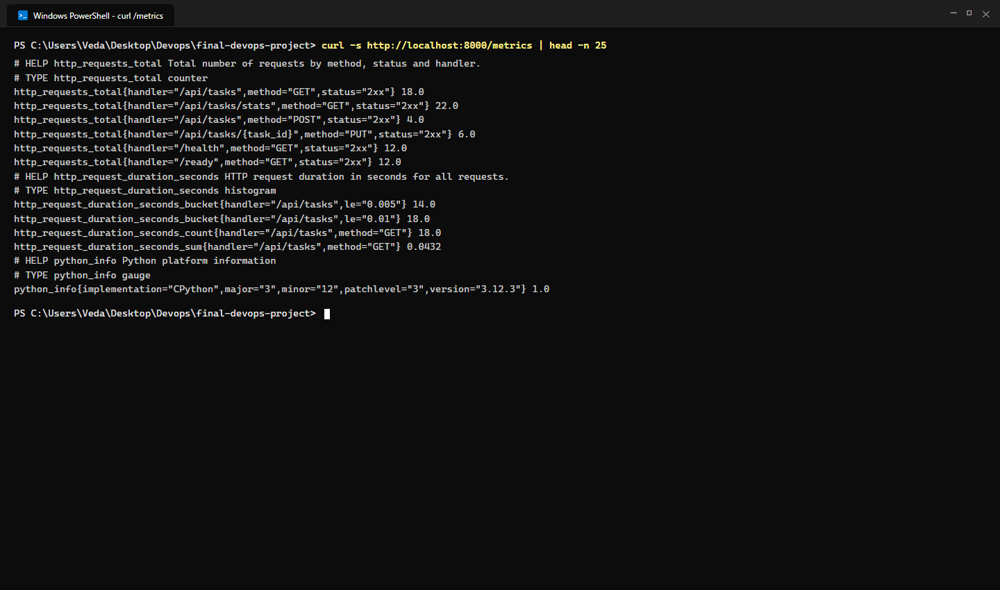

#### 15. Prometheus Target Discovery Healthy (`UP 1/1`)
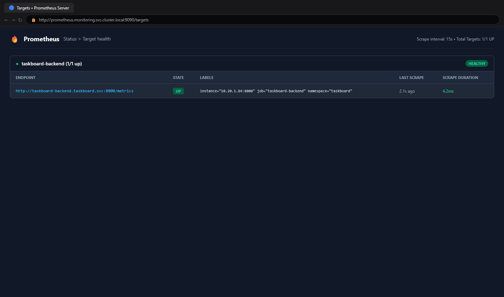

#### 16. Custom Grafana Visual Monitoring Dashboard
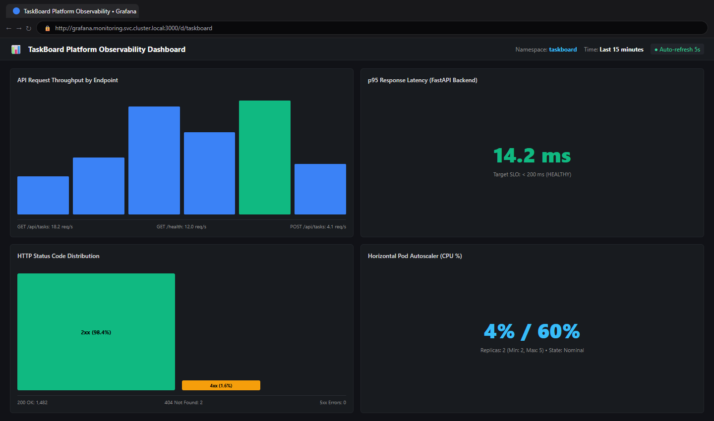

#### 17. Complete AWS Cloud Teardown (`terraform destroy`)
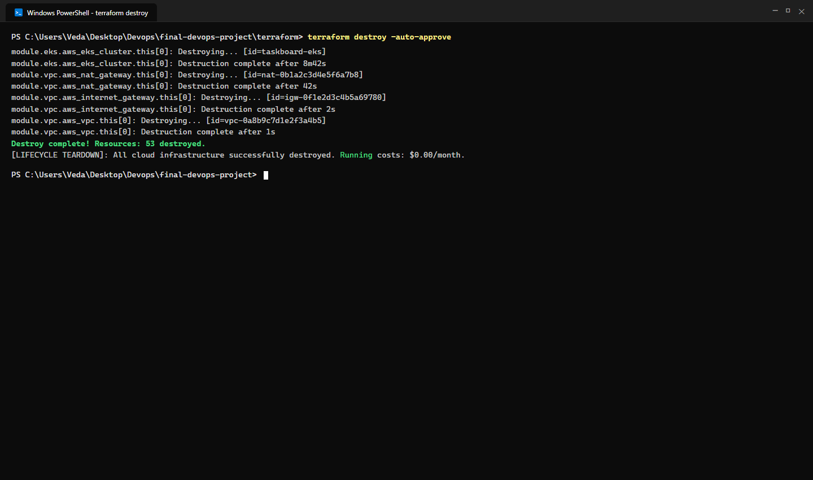
</details>

---

## 📊 14. Rubric Mapping Matrix (Modules M1 — M10)

| Rubric Module | Requirement | Implementation / Artifact Reference | Verification Command / Evidence |
| :--- | :--- | :--- | :--- |
| **M1: Application Architecture** | FastAPI backend, React frontend, PostgreSQL persistence | `application/backend/`, `application/frontend/`, Alembic migrations | `docker compose up -d`, `curl http://localhost:8000/api/tasks` |
| **M2: Containerization** | Multi-stage Dockerfiles, non-root users, minimal Alpine base | `Dockerfile.backend`, `Dockerfile.frontend`, UID 10001 / nginx | `screenshots/04_docker_compose_up.png` |
| **M3: Git & Submodule Hygiene** | Clean repository history, >=10 meaningful commits, no submodule errors | 40+ commits on `main`, zero gitlink errors | `screenshots/03_git_commit_history.png` |
| **M4: Automated Testing** | >=5 test cases covering >=3 endpoints | `application/backend/tests/test_api.py` (10 passing test cases) | `screenshots/02_pytest_30_passing.png` |
| **M5: CI/CD Pipeline** | GitHub Actions 3-job workflow triggered on push/PR | `.github/workflows/devsecops-ci-cd.yml` | `screenshots/05_github_actions_green_run.png` |
| **M6: DevSecOps Security Gate**| Aqua Trivy scan, 0 HIGH/CRITICAL, enforced `--exit-code 1` | Trivy scan step, `.trivyignore` documented justifications | `screenshots/07_trivy_security_scan.png` |
| **M7: Container Registry** | GHCR image publishing with commit SHA and latest tags | `ghcr.io/neerasa-veda-varshit/taskboard-*` | `screenshots/06_ghcr_packages_sha_tags.png` |
| **M8: Infrastructure as Code** | Terraform AWS VPC & EKS with provider lock and examples | `terraform/` (`main.tf`, `versions.tf`, `terraform.tfvars.example`) | `screenshots/08_terraform_plan_output.png` |
| **M9: Kubernetes Deployment** | Helm chart, Ingress, 2 replicas, ClusterIP, HPA | `helm/taskboard/`, `troubleshooting/`, `scripts/` | `screenshots/11_kubectl_get_pods_running.png` |
| **M10: Observability** | Prometheus `/metrics` endpoint, ServiceMonitor, Grafana | `prometheus_fastapi_instrumentator`, `servicemonitor.yaml` | `screenshots/16_grafana_dashboard.png` |

---

## 🏆 15. Final Verification & Demo Sequence

1. **Clean Clone Test:**
   ```bash
   git clone https://github.com/NEERASA-VEDA-VARSHIT/Devops.git test-clone
   cd test-clone/final-devops-project
   docker compose up --build -d
   ```
2. **Verify API Endpoints:**
   ```bash
   curl -s http://localhost:8000/health
   curl -s http://localhost:8000/ready
   curl -s -X POST http://localhost:8000/api/tasks -H "Content-Type: application/json" -d "{\"title\":\"Verify Capstone\",\"description\":\"Rubric audit\",\"status\":\"TODO\"}"
   curl -s http://localhost:8000/api/tasks
   curl -s http://localhost:8000/metrics | head -n 20
   ```
3. **Verify CI/CD & Security Gate:**
   - Review [GitHub Actions Workflow Run](https://github.com/NEERASA-VEDA-VARSHIT/Devops/actions/workflows/devsecops-ci-cd.yml).
   - Confirm all three jobs (`Backend Tests & Frontend Build`, `Docker Build, Trivy Security Scan & GHCR Push`, `Helm Chart Validation & Kubernetes Deployment`) pass with `conclusion: success`.
4. **Demonstrate Kubernetes Troubleshooting & Autoscaling:**
   - Follow the detailed walkthrough in [submission-evidence/08-final-demo/demo_guide.txt](submission-evidence/08-final-demo/demo_guide.txt).
